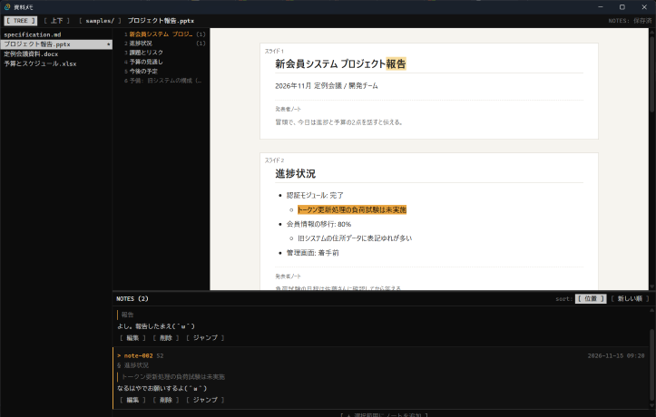

# 資料メモ かきこみ

会議資料（Markdown / Word / Excel / PowerPoint / PDF）を **一切書き換えず**、資料ごとの別ファイル `<資料名>.notes.json` にメモを残すデスクトップアプリです。
（Tauri v2 + React + TypeScript + Tailwind CSS）



## 起動

```sh
npm install
npm run tauri dev     # 開発起動
npm run tauri build   # インストーラ作成
npm test              # ユニットテスト
```

### 名前と版

- 画面・ウィンドウ・インストーラーに出す名前は「資料メモ かきこみ」（`tauri.conf.json` の `productName`・ウィンドウの `title`、`index.html`）
- 内部の名前は英数字の `document-memo-kakikomi`（npm・Cargo のパッケージ名、実行ファイル名 `mainBinaryName`、`localStorage`・設定ファイルの名前）。識別子は `com.document-memo-kakikomi.app`
  - 識別子はアプリのデータの置き場所（`%APPDATA%\com.document-memo-kakikomi.app` の開けるフォルダの一覧、`%LOCALAPPDATA%\com.document-memo-kakikomi.app` の PDF のキャッシュと画面の設定（WebView2 の localStorage））になる。変えると前のデータは引き継がれない（前の識別子は `com.shiryomemo.app`）
- 版を上げるときは `package.json`・`src-tauri/Cargo.toml`・`src-tauri/tauri.conf.json` の 3 か所を同じにする（そろっていないと `src/lib/appInfo.test.ts` が失敗する）。画面の版は `package.json` から読む

`samples/` フォルダを開くと動作を試せます（`node scripts/make-sample-docx.mjs` / `make-sample-xlsx.mjs` / `make-sample-pptx.mjs` / `make-sample-pdf.mjs` でサンプルの Word / Excel / PowerPoint / PDF を再生成。PDF は Microsoft Edge で作ります）。

## 使い方

1. `[ 資料フォルダを開く ]` でフォルダを選ぶ（前回のフォルダ・資料は自動で開き直します）
2. 資料のテキスト（Excel はセル範囲）を選択 → `[ + ノート ]` ボタン / Ctrl+M / 右下のボタンでノート追加（Ctrl+Enter で保存）
   - 資料にない話（脱線・口頭の補足）は `[ + 全体メモ ]` / Ctrl+Shift+M で、文言を選ばずに「資料全体」か「いま見ている場所」（PowerPoint は表示中のスライド、PDF は表示中のページか画面上部の見出しの節、Excel は表示中のシート、Word・Markdown は画面上部の見出しの節）に付けられます
3. ハイライトをクリックすると対応ノートへ、ノートの `[ ジャンプ ]` で資料の該当箇所へ移動
   - 見出しのある Word・Markdown は、左の「目次」で見出しへ移動できます（いま読んでいる節を色で示し、節ごとのノート数を出す。`«` で閉じる）。PowerPoint はスライド一覧、PDF はページ一覧（見出しの取れる PDF は目次付き）
   - ハイライトの色はノートの種類ごと（メモ 黄・決定 緑・宿題 桃・質問 紫）。選択中のノートは橙
   - 削除したノートは、一覧の下の `[ 元に戻す ]` か Ctrl+Z で元の位置に戻せます（資料ごとに新しい順で 20 件まで。入力欄での Ctrl+Z は文字の取り消し）
4. ノートには種類（メモ・決定・宿題・質問）を付けられます。宿題・質問には担当者・期限・優先度（高・中・低）・完了（回答済み）を付けられ（完了にした日を記録し、期限を過ぎていれば「N日遅れ」と出します）、一覧の `filter:` で種類や「未完了」に絞り込めます。`sort:` の `優先度` で未完了の宿題・質問を優先度・期限順に先頭へ並べます（ボードの `優先度別` も同じ）
   - ノートには書いた人の名前を、完了にしたときは完了にした人の名前も記録します（ノートファイルを Git や同期フォルダで共有したときに、誰のメモか分かるように）。名前は git の `user.name` を使い、ヘッダーの `[ 名前: … ]` で変えられます（この PC だけの設定。空にすると記録しません）
5. ノート一覧の `[ 議事録 ]` で、ノートから議事録の Markdown を作ってクリップボードにコピー・`.md` で保存（下記）
6. ヘッダーの `[ BOARD ]` で、フォルダ全体の未完了の宿題・質問と、決定事項の台帳を表示（下記）
7. ヘッダーの `[ 左右 ]` / `[ 上下 ]` で資料とノートの配置を切り替え（横に長い Excel は上下が見やすい）。境界線のドラッグでサイズ変更

### 会議中の素早い入力

コメントの先頭に次の記法を書くと、保存時に種類・担当者・期限・優先度として読み取ります（記号は全角でも可）。

| 記法 | 意味 |
| --- | --- |
| `/決` `/宿` `/質` `/メ`（`/決定` `/宿題` `/todo` `/質問` `/q` なども可） | 種類 |
| `@田中` | 担当者（種類を書かなければ宿題になる） |
| `!12/1` `!2027/1/15` `!明日` `!+3` | 期限（年を省くと今年。半年以上前になるなら来年） |
| `/高` `/中` `/低` | 優先度（種類を書かなければ宿題になる） |

例: `/宿 @田中 !12/1 /高 見積もりを再提出`。先頭から空白区切りで続く間だけ読み、記法でない語が出たらそこから後はすべてコメントです。

### 全体メモのテンプレート

全体メモを書き始めると、入力欄の上に `テンプレート:` のボタンが出ます。押すと「出席者 / 議題 / 次回日程」などの定型文が入り、カーソルは 1 行目の末尾に置かれます（すでに書いた文は消さずに後ろへ足します）。
会議の冒頭に資料全体の全体メモとして入れておくと、議事録の書き出しでは「メモ」の節の先頭（`（資料全体）`）に出ます。

テンプレートは資料フォルダ直下の設定ファイル `.document-memo-kakikomi.json` の `templates` に書きます（下記の `docxHeadings` と同じファイル）。フォルダを Git や同期フォルダで共有すれば、メンバー全員が同じ型で書けます。
書かなければ「定例会」のテンプレートを 1 つ出します。`[]` にするとボタンを出しません。

```json
{
  "templates": [
    { "name": "定例会", "text": ["出席者：", "欠席：", "議題：", "1. ", "次回日程："] },
    { "name": "レビュー会", "text": "指摘者：\n対象版：\n総評：" }
  ]
}
```

`text` は文字列（改行は `\n`）か、1 行ずつの配列で書けます。

### 議事録の書き出し

ノート一覧の `[ 議事録 ]` で、開いている資料のノート（種類の絞り込みに関係なく全件）から議事録の Markdown を作ります。

- 同じ資料を毎回の会議で使うときは、上部の `回:` で 1 回分だけを書き出せます（下記「会議の回」）。そのときの日付・ファイル名はその回の日です

- 決定事項・宿題・質問を先頭に集め、残りのメモは資料の見出し（Word・Markdown は直前の見出し、PowerPoint はスライド、PDF はページ、Excel はシート）ごとにまとめます。どれも資料上の位置順です
- 各行の末尾に出典（見出しと `¶12`・`L3`・`S3`・`p.2`・`予算!C4` などの位置）を付けます。「資料の引用を含める」で、ノートを付けた文言も `>` で添えます
- 表示した Markdown はその場で手直しでき、`[ クリップボードにコピー ]` で Slack・Confluence などに貼れます
- `[ .md で保存 ]` は保存ダイアログで場所を選びます（既定は資料と同じフォルダ、`<資料名>_議事録_<日付>.md`）。ノートを付けている資料や書き出し元の資料には上書きしません

```md
## 決定事項

- 予算は案Bで進める（§ 2. 予算 ¶5）

## 宿題

- [ ] 見積もりを再提出 — @田中 〜12/1（§ 2. 予算 ¶6）
```

### 会議の回

定例会で同じ資料を毎週使うとき、ノートを書いた日を会議の回とみなして分けられます。

- ノートの日付が 2 日以上に分かれると、ノート一覧の上に `回:` の選択欄が出ます（`すべての回` か `11/20(金)` のような日付）。選んだ回のノートだけを一覧に出し、`filter:` の件数もその回で数えます
- `sort: 新しい順` ですべての回を出しているときは、日付ごとに `── 11/20(金) ──` の区切りを入れます
- 回を選んだままノートを追加すると今日の回に、BOARD・元に戻すで別の回のノートを出すとすべての回に切り替えます。別の資料を開くとすべての回に戻ります
- 資料のハイライトは回に関係なくすべて出します
- 日付は作成日時のこの PC での日付です。前の回に書いた宿題を今回完了にしても、その宿題は前の回に入ったままです

### 宿題・質問ボードと決定事項の台帳

ヘッダーの `[ BOARD ]` で、フォルダ内のすべての資料のノートを集めて表示します。上部のタブで「宿題・質問」と「決定事項」を切り替えます。どちらも項目を押すと、その資料を開いて該当箇所へ移動し、`[ Markdown をコピー ]` で表示中の一覧をコピーできます。開いている間にノートファイルが外部で変更されたら読み直し、開いている資料は未保存の編集も反映します。

#### 宿題・質問

未完了の宿題・未回答の質問を一覧します（会議冒頭の「先週の宿題」確認用）。

- 「種類」で、すべて・宿題だけ・質問だけ（先生・担当者に聞くリスト）に切り替えます
- 行の右の `[ 完了 ]` / `[ 回答済み ]` で、その資料を開かずに完了・回答済みにできます。直後なら `[ 元に戻す ]` で戻せます
  - 開いている資料はノート一覧と同じく自動保存します。ほかの資料はノートファイルを読み直してそのノートだけを変えて書き込み、その間に外部で変更されていたら書き込みません
  - 回答をメモしたいときは、項目を押して資料のノートへ移動し、コメントに追記します
- 上部に「期限切れ・今週（今日〜今週の日曜）・担当なし」の件数を出します。押すとその条件で絞り込みます。担当なしは担当者が空の宿題です（質問は数えません）
- 並べ方は「担当者別」（担当なしを先頭に目立たせる）・「期限順」（期限切れ・今週・来週以降・期限なし）・「優先度別」（高・中・なし・低）。どれも中は期限の近い順です
- 資料が見つからないノート（孤立したノート）は移動できません
- コピーは議事録と同じ形式（`- [ ] 内容 — @担当 〜期限（資料 位置）`）です
- `[ CSV で保存 ]` / `[ Issue 用 Markdown を保存 ]` で、表示中の一覧（種類・絞り込み・並べ方）をファイルに書き出せます（保存先は保存ダイアログで選ぶ。既定は資料フォルダ）
  - CSV は `種類,内容,担当,期限,優先度,資料,位置,書いた人,作成日,ノートID`。Excel で開けるよう UTF-8（BOM 付き）。`=` などで始まる値は `'` を前に付けます（数式として実行させない）
  - Issue 用 Markdown は、表示中の宿題・質問を 1 つの Issue のチェックリストにしたものです。`gh issue create --title "未完了の宿題（2026-11-28）" --body-file <保存したファイル>` で GitHub の Issue にできます。担当者には `@` を付けません（GitHub の同名のアカウントに通知が飛ばないように）
- フォルダを開いたとき、期限切れ・今日が期限・明日が期限の宿題・質問があれば、上部に件数を知らせます（`[ BOARD で見る ]` でボードを開く）

#### 決定事項

すべての資料の決定事項を、決めた日（ノートを作った日）ごとにまとめて一覧します（「あれいつ決めたっけ？」用）。

- 検索欄で、内容・付けた文言・資料名・見出しを探します。空白で区切ると、すべての語を含むものに絞ります（全角・半角、大文字・小文字は区別しません）。Esc で検索語を消します
- 並べ方は「新しい順」「古い順」
- コピーは日付ごとの箇条書き（`- 内容（資料 位置）`）です。置き換えた・置き換えられた決定は、下に `置き換え元:` / `置き換え先:` を添えます

決定を変えたときは、新しい決定のノートの `[ 置き換え元… ]` で、前の決定を台帳から選んでリンクできます（前の決定は別の資料にあってもよい）。

- 台帳では、置き換えられた決定を取り消し線と `[置換済]` で表し、`← 置き換え元` / `→ 置き換え先` を押すとその決定へ移動します。「置き換え済みを隠す」で今有効な決定だけにできます
- ノート一覧の決定には `← 置き換え元: …` が出ます（`[ 解除 ]` でリンクを外す）。議事録にも `置き換え元:` を添えます
- 書き換えるのは開いている資料のノートだけです（前の決定のノートファイルは変えません）。自分を置き換えている決定は選べません（リンクが循環しないように）

## ノートファイル

`specification.md` → `specification.md.notes.json`（拡張子違いの同名資料と衝突しないよう、資料のファイル名をそのまま含めます）。
最初のノートを追加したときに作成され、変更は 0.5 秒後に自動保存されます（一時ファイル経由のアトミック書き込み）。
保存の直前に、ノートファイルが外部（git pull・同期フォルダなど）で変更されていないか確認します。変更されていた場合は上書きせず、アプリ側の編集を `<資料名>.notes.conflict-<日時>.json` に退避して、外部の内容を読み込み直します。

```json
{
  "version": 1,
  "source": { "file": "specification.md" },
  "notes": [
    {
      "id": "note-001",
      "kind": "action",                    // 省略時はメモ。"decision" | "action" | "question"
      "comment": "来月のリリースまでに再確認",
      "assignee": "田中",                  // 宿題・質問のみ。省略可
      "due": "2026-12-01",                 // 宿題・質問のみ。省略可
      "priority": "high",                  // 宿題・質問のみ。"high" | "medium" | "low"。省略可
      "done": true,                        // 完了（質問は回答済み）。省略時は未完了
      "doneAt": "...", "doneBy": "佐藤",   // 完了にした日時と人。完了のときだけ。省略可
      "supersedes": { "id": "note-…", "doc": "../第3回/資料.docx", "text": "前の決定" }, // 決定のみ。置き換えた前の決定。省略可
      "author": "田中",                    // 書いた人。省略可
      "createdAt": "...", "updatedAt": "...",
      "anchor": {
        "type": "text",
        "quote": "ここが重要な仕様です",
        "prefix": "…直前32文字", "suffix": "直後32文字…",
        "start": 25, "end": 35,
        "lineStart": 3, "lineEnd": 3,      // Markdown のとき
        "paragraph": 5, "heading": "2.1 …", // Word のとき
        "slide": 3, "slideId": 258,          // PowerPoint のとき（heading はスライドのタイトル）
        "page": 2,                           // PDF のとき
        "sourceSha256": "…ノート作成時の資料のハッシュ"
      }
    }
  ]
}
```

- `start`/`end` は **表示テキスト** 上の文字オフセット、`lineStart`/`lineEnd` は Markdown ソースの行番号（参考情報）
- キー順を固定・整形して出力するので Git の差分が読みやすい
- `supersedes` は決定を変えたときの前の決定です。`id` で探し（同じ ID が複数あれば `doc` で見分ける）、`doc` はこの資料のフォルダからの相対パス、`text` は置き換えたときの前の決定の内容の控えです

全体メモは `anchor.type` が `"place"` で、`scope` が付け先です（`doc`: 資料全体 / `slide`: スライド / `page`: PDF のページ / `sheet`: シート / `heading`: 見出しの節）。

```json
"anchor": {
  "type": "place",
  "scope": "slide",
  "slide": 3, "slideId": 258,   // slide のとき。位置の特定にはスライド ID を使う
  "heading": "体制",            // heading のときは見出しの文言（位置の特定に使う）、slide のときはスライドのタイトル
  "quote": "体制",              // 表示用の付け先の名前（資料全体は空）
  "sourceSha256": "…"
}
```

スライドは ID、シートは名前、見出しは文言で探します。文言に付けていないので資料が更新されても古くならず、付け先が見つからない（スライド削除・見出しの変更など）ときだけ「該当箇所なし」になります。

Excel のノートはセル範囲に付けます（`anchor.type` が `"cell"`）。

```json
"anchor": {
  "type": "cell",
  "sheet": "予算",
  "ref": "C4:D4",
  "quote": "1,350 | 1,350",
  "values": [["1,350", "1,350"]],   // 範囲の左上 最大 10×10 の表示値
  "rowHeader": "人件費",              // その行で範囲より左にある最初の値
  "colHeader": "5月",                 // その列で範囲より上にある最初の値
  "sourceSha256": "…"
}
```

## 対応形式

| 形式 | 表示 | 位置の表示 | 版の判定（sha256） |
| --- | --- | --- | --- |
| Markdown (.md) | react-markdown + GFM（文字コードは UTF-8・Shift_JIS・EUC-JP などを判定） | ソースの行番号 `L12-14` ＋ 直前の見出し | ファイルそのもの |
| Word (.docx) | mammoth.js で構造を HTML 化（見出し・段落・リスト・表・画像・リンク・脚注） | 段落番号 `¶12` ＋ 直前の見出し | 本文テキスト（再保存・書式・見出し設定の変更では変わらない） |
| PowerPoint (.pptx) | 図形・画像・線をスライド上の位置どおりに並べた「図」と、文字のカードの「文字」を切り替え（発表者ノートも表示） | スライド番号 `S3` ＋ スライドのタイトル | スライドの文字と発表者ノート（再保存・書式の変更では変わらない） |
| PDF (.pdf) | pdf.js でページを画像にし、上に透明な文字の層を重ねる（見た目はそのまま） | ページ番号 `p.2`＋直前の見出し（タグ付き PDF の構造かしおりから） | ページの文字（書き出し直しで日時などだけ変わっても変わらない） |
| Excel (.xlsx / .xlsm / .xls) | SheetJS でセルの表示値を表に（シートのタブ・結合セル・列幅・表示形式） | `予算!B3:D5` ＋ 行・列の見出し | シート名とセルの表示値（再保存・書式の変更では変わらない） |

### Word の見出しスタイル

1. **自動判定**: 段落スタイルの「アウトラインレベル」（基準スタイルから引き継いだものを含む）を読み、見出しにします。
   Word のナビゲーションウィンドウに見出しとして出るスタイルなら自動で認識されます。
2. **設定ファイル**: アウトラインレベルを持たない独自スタイルは、資料フォルダ直下の `.document-memo-kakikomi.json` で指定します。
   変更は保存すると即座に反映されます。

```json
{
  "docxHeadings": {
    "社内見出し大": 1,
    "社内見出し中": 2,
    "強調ボックス": 0
  }
}
```

値は見出しレベル 1〜6、`0` は「自動判定されても見出しにしない」。見出しとして扱ったスタイルは、資料上部の「Word 変換情報」で確認できます。
未対応のスタイル名も同じ欄に `Unrecognised paragraph style: 'xxx'` として表示されます。

Word の制限:
- フォント・色・ページ割りなどの見た目は再現しません（ページ番号も出せません）
- テキストボックスや図形内の文字は表示されないことがあります。変換できなかった要素は資料の上部に一覧表示します
- 古い `.doc` 形式は非対応。Word が開いている間のロックファイル `~$xxx.docx` は一覧・監視から除外します

### PowerPoint

- スライドを縦に並べて表示し、左の「スライド一覧」から各スライドへ移動できます（ノートの件数も表示）
- スライド一覧の上の「表示:」で切り替えます（選んだほうを覚えます）。どちらの表示でも文字はそのまま選べ、付けたノートも同じです
  - 図（既定）: 図形・テキストボックス・画像・線や矢印を、位置・大きさ・塗り・枠線・文字の大きさと色どおりに並べます（テーマの色、マスター・レイアウトの飾り、背景も）
  - 文字: スライドごとの文字のカード。文字は「タイトル → 上から・左から」の順に並べ、画像などは `[画像: 代替テキスト]` のような目印にします
- グラフ・SmartArt の図・動画・埋め込みオブジェクトは目印だけを表示します（SmartArt は文字を箇条書きで出す）。影・3D などの効果、アニメーションは再現しません。詳しくは `doc/pptx.md`
- 発表者ノートは各スライドの下に表示し、本文と同じようにノートを付けられます
- 非表示のスライドも「（非表示）」と付けて表示します
- 古い `.ppt` 形式は非対応です

### PDF

- ページを縦に並べて表示し、左の「ページ一覧」から各ページへ移動できます（ノートの件数も表示）。ページの幅は表示欄に合わせます
  - 見出しの取れる PDF（下記）では、ページの下にそのページの見出しを字下げで並べた目次になります。見出しを押すとそこへ移動し、いま読んでいるページと節を色で示します
- 文字の入った PDF なら、文字を選んでノートを付けられます。スキャン画像だけの PDF は表示できますが文字を選べないので、全体メモ（資料全体・ページ）を使います
- 全体メモは、資料全体・いまの見出しの節（見出しの取れる PDF）・いまのページに付けられます（既定はページ）
- ページ画像は、表示欄の近くのページだけを描きます。描いたページと文字の層はアプリのキャッシュフォルダ（`%LOCALAPPDATA%\com.document-memo-kakikomi.app\pdf-cache`、資料フォルダには置かない）に保存し、2 回目からはすぐに開きます（合計 512MB を超えたら古いものから消す）
- ノートにはページ番号に加えて直前の見出しを記録します（`§ 3. 課題と相談したいこと p.2`）。見出しは、Word などから書き出したタグ付き PDF なら本文の構造（H1〜H6）から、構造に見出しが無ければしおり（アウトライン）から取ります（しおりの見出しはしおりの題名）。どちらも無い PDF はページ番号だけです
- 康熙部首（`⽉` `⽇` など、フォントによって「月」「日」がこの文字で取り出される）や合字は普通の文字に直してから扱います
- 段組みの PDF では、選択や引用の文字の順番が見た目と違うことがあります
- パスワード付きの PDF は開けません。PDF 内のフォーム・注釈・リンクは表示しません
- pdf.js の補助データ（日本語などの文字の対応表 `cmaps`、JBIG2・JPEG 2000 画像と ICC プロファイル用の wasm）をアプリに同梱しています。埋め込みの無い標準フォントは同梱せず、OS のフォントで代用します

### Excel

- セルの値は Excel の表示形式（桁区切り・日付など）を適用した文字列で表示します。日付の既定の書式は日本語版 Excel に合わせて `2026/4/1` 形式
- 数式は再計算せず、Excel が保存したときの計算結果を表示します
- 選択: クリック・ドラッグ、Shift+クリックで範囲を拡張、行・列番号のクリックで行・列全体。結合セルにかかると結合セル全体に広がります。Ctrl+C で選択範囲をタブ区切りでコピー
- 文字色・塗りつぶし・罫線、グラフ・画像・図形、条件付き書式は表示しません。非表示のシートは表示せず、非表示の行・列は通常どおり表示します
- 大きなシートは 3,000 行・200 列（かつ 15 万セル）までを表示します

SheetJS は npm レジストリの版（0.18.5）が古く既知の脆弱性もあるため、公式の配布 URL（`https://cdn.sheetjs.com/xlsx-0.20.3/xlsx-0.20.3.tgz`）から版を固定してインストールしています（Apache-2.0）。`package-lock.json` にハッシュを記録しているので、中身が変わればインストール時に検出されます。

## 資料が変更されたとき

フォルダを監視しており、外部で資料が編集されると自動で再読込して再アンカーします。

| 状態 | 意味 |
| --- | --- |
| （表示なし） | 記録位置にそのまま存在 |
| 位置を自動追従 | 引用文は同じで位置がずれていた（前後の文脈で特定） |
| 引用文が変更 | 引用文が書き換わっていた（あいまい検索で推定、波線ハイライト） |
| 該当箇所なし | 見つからない。テキストを選択して「📍 選択範囲に付け直す」で手動修正 |

PDF はページを入れ替えると番号が変わるので、ページで探す範囲を絞らず、資料全体から探します。

PowerPoint の再アンカーは、スライド ID（スライドを並べ替えても変わらない）が同じスライドの中を優先して探し、見つからなければ資料全体から探します。スライドが移動しても、同じ文言が別のスライドにあっても、元のスライドを指し続けます。

Excel の再アンカーは「記録位置に同じ値と見出し → 同じ値の並びを探して見出し一致・近さで選ぶ（行・列の挿入、シート名の変更に追従） → 行・列見出しの交点 → 記録位置の値が半分以上同じ」の順に試します。

ノートの `sourceSha256` が現在の資料と異なると警告バナーが出ます。「現在の版でアンカーを確定」で推定位置を保存します。
`.notes.json` が外部で変更された場合（git pull など）も自動で読み直します。壊れた JSON は上書きせず編集をロックします。

資料をリネーム・移動・削除すると、ノートファイルだけが残ります。これはファイル一覧の下の「孤立したノート」に出て、付け替え先（同じ名前の資料＝移動、同じフォルダのノートの無い同じ形式の資料＝名前の変更、または任意の資料）を選んで付け替えられます。

## 構成

- `src-tauri/src/lib.rs` — ファイル一覧・読込・SHA-256・ノート書き込み（`.notes.json` 専用）・議事録とボードの書き出しの保存（保存ダイアログで選んだ `.md` / `.csv` のみ）・PDF のキャッシュ・フォルダ監視
- `src/lib/anchor.ts` — アンカー作成と再アンカー（完全一致 → 文脈スコア → diff-match-patch あいまい検索 → 前後文脈）
- `src/lib/dom.ts` — 表示 DOM ⇔ テキストオフセット変換
- `src/lib/document.ts` / `docx.ts` — 形式ごとの読み込み（Word は 見出しスタイル判定 → mammoth → DOMPurify → 段落番号付与）
- `src/lib/pptx.ts` / `pptxDraw.ts` — PowerPoint の読み込み（JSZip でスライドの XML を読み、スライドごとの HTML に） / 図形・線・色・書式を CSS 変数にする
- `src/lib/pdf.ts` — PDF の読み込み（pdf.js でページ画像と文字の層の HTML に）。補助データは `vite.config.ts` の `pdfjsAssets` で同梱
- `src/lib/sheet.ts` / `xlsx.ts` — Excel のシートデータとセル範囲アンカー（SheetJS に依存しない） / SheetJS による読み込み
- `src/lib/config.ts` — フォルダ設定 `.document-memo-kakikomi.json` の読み込み（Word の見出しスタイル・全体メモのテンプレート）
- `src/components/Viewer.tsx` — Markdown 表示、選択検知、CSS Custom Highlight API によるハイライト（資料 DOM を変更しない）
- `src/components/SheetViewer.tsx` — Excel 表示（表は一度だけ描画し、選択・ハイライトは上に重ねた枠で描く）
- `src/lib/noteMeta.ts` / `author.ts` — ノートの種類・担当者・期限・優先度と、会議中の入力記法 / 書いた人・完了にした人
- `src/lib/minutes.ts` — ノートから議事録の Markdown を作る
- `src/lib/session.ts` — 会議の回（ノートの作成日）で分ける
- `src/lib/board.ts` / `ledger.ts` / `supersede.ts` — フォルダ全体のノートの集め方と、宿題・質問ボードの集計（担当者別・期限順・優先度別）・決定事項の台帳（日付ごと・検索）・決定の置き換えのリンク
- `src/lib/place.ts` — 全体メモ（資料全体・スライド・ページ・シート・見出しの節）のアンカー
- `src/lib/toc.ts` — 見出しの目次（節の範囲・ノート数・いまの節）
- `src/lib/taskExport.ts` — 宿題・質問ボードの CSV / Issue 用 Markdown の書き出し
- `src/components/NotesPanel.tsx` / `FileTree.tsx` / `MinutesDialog.tsx` — ノート一覧・ファイルツリー・議事録の書き出し
- `src/components/FolderBoard.tsx` / `TaskBoard.tsx` / `DecisionLedger.tsx` — フォルダ全体のノートのダイアログ（宿題・質問ボード / 決定事項の台帳）

## ライセンス

このアプリは MIT ライセンスです（`LICENSE`）。同梱しているライブラリ・データのライセンスは `THIRD_PARTY_LICENSES.md` にまとめ、ビルドしたアプリにも同じファイルを入れています。
依存を追加・更新したら `node scripts/make-third-party-licenses.mjs` で作り直してください（npm の本番依存と pdf.js の補助データが対象。Rust のクレートはまだ含めていません）。

主なもの: pdf.js（Apache-2.0）、SheetJS（Apache-2.0）、mammoth（BSD-2-Clause）、JSZip（MIT または GPL-3.0 から MIT を選択）、DOMPurify（MPL-2.0 または Apache-2.0）、diff-match-patch（Apache-2.0）、React ほか（MIT）。
pdf.js の補助データは Adobe CMaps（BSD-3-Clause）、PDFium の JBIG2（BSD-3-Clause）、OpenJPEG（BSD-2-Clause）、qcms（MIT）など。

## 今後の拡張

予定している機能と進み具合は `TASKS.md` にまとめています。
